# Is a Civilization IV-style 3D map feasible for BrowserCol? (#405)

**Recommendation: go-later.** The tech works and is cheap enough on integrated graphics. The cost is in art, in rewriting the map's input and overlay code, and in dropping Tileset art mods for the 3D map. Do it after 1.0, as an optional third Tileset kind. Build it as a ground-and-relief layer with Colonization-oblique and Civ IV-tilt cameras. Don't start before there is an artist or an agreed model style.

## What was built

A throwaway prototype in `tools/proto-civ4-map/` (not production code, not tested beyond these runs). It is **three.js 0.187.0**, WebGL2 only. I chose it over raw WebGL2 for speed of writing; the whole scene is 9 draw calls, so its overhead doesn't matter. It draws real maps exported from the Engine (`MapJson.terrain`, seed 3): the default 58x72 Top-down map, and a 41x102 Isometric-shaped map (92x91 box, 4,182 tiles, corner tiles absent).

- **One terrain mesh** with 4x4 vertices per tile. Height per tile type (hills 0.55, mountains 0.8, water below 0) is smoothed over neighbours, plus noise on hills and mountains.
- **Ground blending in the shader.** A tile-id texture picks one of 16 procedural ground textures per tile (a texture array). The shader blends the four nearest tiles in a soft band at the edges. There are no edge pieces. Steep slopes show rock.
- **Water** is one plane over the low ground. Depth colour, foam on the shore and absent tiles (the Isometric shape's corners) all come from the height texture.
- **Procedural low-poly models, instanced:** 3-6 conifers or broadleaf trees per forest tile, one rock peak per mountain tile (3 variants), 40 unit pawns and 10 ships on tile centres.
- **One sun** (a directional light plus a hemisphere light, matched in the terrain shader) lights everything.
- **Grid toggle** (a shader line at tile edges), pan, zoom, and four cameras on one scene: Top-down straight (orthographic, 90 degrees down), Colonization oblique, Civ IV tilt and Isometric.

**What it can show:** cost, readability of terrain and relief, and the architecture. **What it cannot show:** final art quality. Every model and texture is procedural placeholder, so nothing here is "Civ IV-like" art. It is a rough low-poly scene that shows how the same data can be drawn.

## The four cameras on one scene

| Camera | How | Look |
|---|---|---|
| **Top-down straight** | Orthographic, straight down, north up | Ground square, but trees, peaks and units show as blobs, gems and balls |
| **Colonization oblique** | Orthographic, straight down, height sheared up the screen by `k` (0.8) | Ground stays square and north up. Trees, peaks, units and ships show their sides |
| **Civ IV tilt** | Perspective, fov 35 degrees, 45 degrees down, north up | Square tiles become trapezoids. Real depth, real horizon feel |
| **Isometric** | Orthographic, yaw 45, pitch 30 | The same scene turned. The Isometric-shaped map is a screen rectangle |

Yes, **one scene gives all of them.** Only the camera matrix changes (the oblique one is a custom projection matrix: `clip.y = sy*(y + k*height)`, and a depth term that sorts north-south first, so further south draws over further north). Camera, grid and `view.yaw` are the only things that differ. The Isometric-shaped map shows as a rectangle in Isometric. In the Top-down camera it shows as a big diamond, and the Top-down map in Isometric is a diamond too, as ADR 0014 says (`isometricmap-in-topdown-far.jpg`, `topdownmap-in-iso-far.jpg`). The oblique view needs the ground flattened (`relief` 0.35 in the prototype), because a sheared hill would otherwise slide up the screen off its tile.

## Numbers

Measured with a scripted pan and zoom path, 8 s, in headless Chromium on the host's **integrated GPU** (the Ryzen 7 7700X's Raphael iGPU, 2 CUs, through Mesa). The owner's RX 6600 was not used. The "work" time is a frame drawn and read back (a 1 px `readPixels` blocks until the GPU is done), so it is GPU plus driver time, not just JS. 1-minute load was 2-6 for these runs, always under 8. Raw rows are in `tools/proto-civ4-map/results/`; `results/table.py` prints this table.

| Window, dpr | Camera | Pan and zoom, 1x CPU: p50 / p95 | 6x CPU: p50 / p95 | Whole map in view, 1x: p50 / p95 | Load to first frame, 1x / 6x |
|---|---|---|---|---|---|
| 1280x720 @1x | Top-down straight | 4.2 / 5.2 ms | 4.3 / 5.3 ms | 4.2 / 5.0 ms | 236 / 1575 ms |
| 1280x720 @1x | Colonization oblique | 4.1 / 5.0 ms | 4.1 / 5.3 ms | 4.0 / 4.8 ms | 234 / 1586 ms |
| 1280x720 @1x | Civ IV tilt | 4.3 / 5.1 ms | 4.4 / 5.6 ms | 4.1 / 4.9 ms | 244 / 1154 ms |
| 1280x720 @1x | Isometric | 4.2 / 5.2 ms | 4.2 / 5.5 ms | 3.8 / 4.6 ms | 275 / 1579 ms |
| 1280x720 @2x | Top-down straight | 7.3 / 8.6 ms | 7.4 / 8.8 ms | 6.6 / 7.3 ms | 227 / 1567 ms |
| 1280x720 @2x | Colonization oblique | 7.1 / 8.3 ms | 7.2 / 8.6 ms | 5.9 / 6.6 ms | 243 / 1594 ms |
| 1280x720 @2x | Civ IV tilt | 7.7 / 9.3 ms | 7.7 / 9.6 ms | 6.3 / 7.0 ms | 249 / 1589 ms |
| 1280x720 @2x | Isometric | 7.4 / 10.6 ms | 7.3 / 11.1 ms | 5.6 / 6.4 ms | 276 / 1230 ms |
| 1920x1080 @1x | Top-down straight | 6.2 / 7.4 ms | 6.2 / 7.9 ms | 5.6 / 6.6 ms | 244 / 1176 ms |
| 1920x1080 @1x | Colonization oblique | 6.0 / 7.1 ms | 6.1 / 7.9 ms | 5.5 / 6.6 ms | 228 / 1557 ms |
| 1920x1080 @1x | Civ IV tilt | 6.3 / 7.6 ms | 6.3 / 8.0 ms | 5.8 / 6.9 ms | 250 / 1559 ms |
| 1920x1080 @1x | Isometric | 6.1 / 7.8 ms | 6.2 / 8.1 ms | 5.0 / 6.1 ms | 254 / 1201 ms |
| 1920x1080 @2x | Top-down straight | 12.2 / 15.3 ms | 12.3 / 15.2 ms | 9.3 / 10.4 ms | 231 / 1582 ms |
| 1920x1080 @2x | Colonization oblique | 11.7 / 14.6 ms | 11.8 / 14.6 ms | 9.0 / 10.1 ms | 239 / 1591 ms |
| 1920x1080 @2x | Civ IV tilt | 12.7 / 15.7 ms | 12.8 / 16.0 ms | 10.0 / 11.0 ms | 263 / 1593 ms |
| 1920x1080 @2x | Isometric | 11.4 / 16.5 ms | 11.5 / 17.3 ms | 7.8 / 9.0 ms | 267 / 1622 ms |

Other measurements (the same for every camera):

- **Draw calls 9.** **Triangles 261k** on the Top-down map (terrain 134k, trees and peaks the rest) and 282k on the Isometric-shaped one. There is no culling or chunking, so this is the count at every zoom, including the whole map in view. The perspective camera's far zoom costs the same as the others (4.1 against 4.2 ms at 720p): the cost is pixels, not triangles. With 2x2 vertices per tile it fell to 161k triangles and the time didn't change (11.6 ms at 1080p@2x), so the iGPU is fill-bound.
- **Texture memory** 5.5 MB (16 ground layers of 256x256, with mips, plus three small data textures). **Vertex data** 4-6 MB. About 10 MB of GPU memory in all, nothing uploads while panning.
- **Load** 230-280 ms at 1x CPU, 1.2-1.6 s at 6x. Almost all of it is generating the ground textures on the CPU (143 ms at 1x). Shipped textures would replace that with image decode.
- **The 6x CPU throttle does not change frame time.** JS per frame is about 0.3 ms (a camera matrix and one render call), so the frame is GPU-bound. Throttle only slows loading.
- **Resolution is the lever.** Frame time rises with pixels: 1080p@2x (4K) is 3x the 720p@1x time. Capping `devicePixelRatio` to 1 at 1080p@2x gave 5.9 ms against 12.2 ms.
- **Software GL (no GPU at all), Chromium in the browser image, SwiftShader on 4 CPUs:** about 200 ms a frame at 1280x720@1x (5 fps). At 1080p it was 360-490 ms and at dpr 2 no frame finished in 8 s. A machine with no real GPU can't run this scene.
- **Firefox: not measured.** The headless Firefox in the Playwright image has no WebGL (software GL is blocked), and the host's snap Firefox cannot be driven by this Playwright. The features used (texture arrays, `texelFetch`, half-float textures with linear filtering, instancing) are all core WebGL2, so I expect it to work, but I have not seen it.

**What this means for the 10-year-old netbook.** I could not test Intel HD hardware. By a rough spec comparison the Raphael iGPU has more shader throughput than an HD 500-class part and far more memory bandwidth (DDR5 against single-channel DDR3L), so a netbook will probably be 3-6x slower than the table. That is a guess. At 1280x720@1x that is about 13-25 ms a frame (usable), at 1080p@1x about 19-37 ms (borderline) and at 4K (1080p@2x) about 36-70 ms (too slow). So the 3D map needs a render-scale cap and a "low" preset (fewer trees, no per-pixel blend of four layers). It needs WebGL2, which excludes some pre-2015 integrated GPUs; three.js dropped WebGL1 in r163, and the scene needs texture arrays and instancing anyway.

## Readability

Screenshots are next to this file. Each camera has `-near` (96 px a tile), `-mid` (40 px), `-far` (whole map) and `-mid-grid` for the grid on. All shots are grid off unless named.

| | Top-down straight | Colonization oblique | Civ IV tilt | Isometric |
|---|---|---|---|---|
| **Mid** | 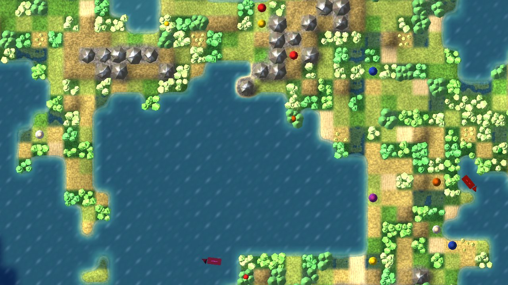 | 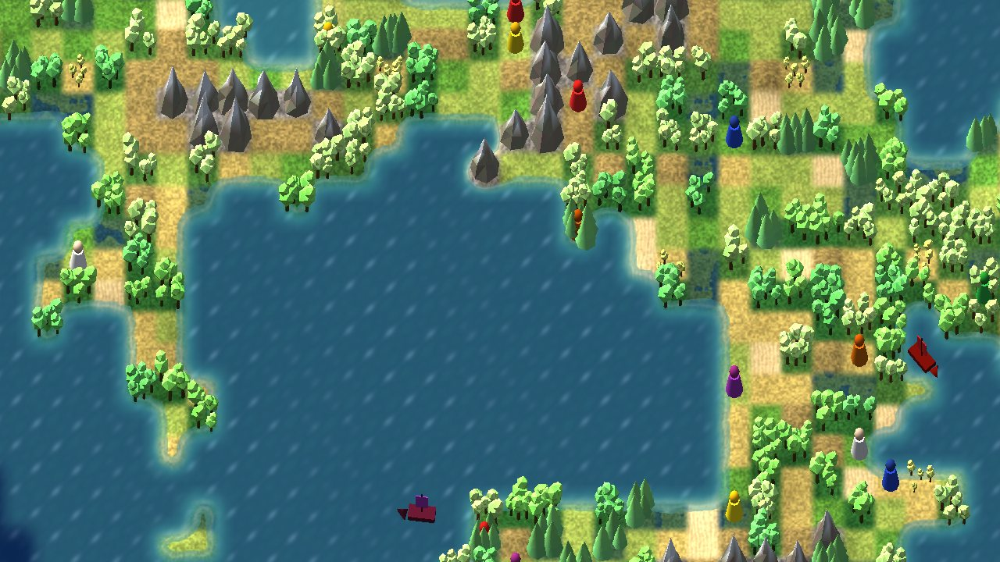 | 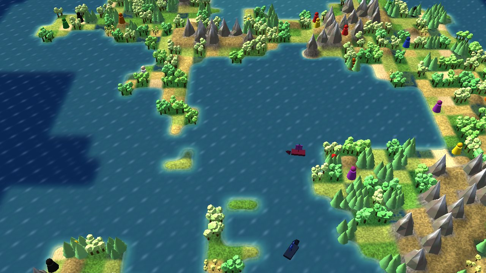 | 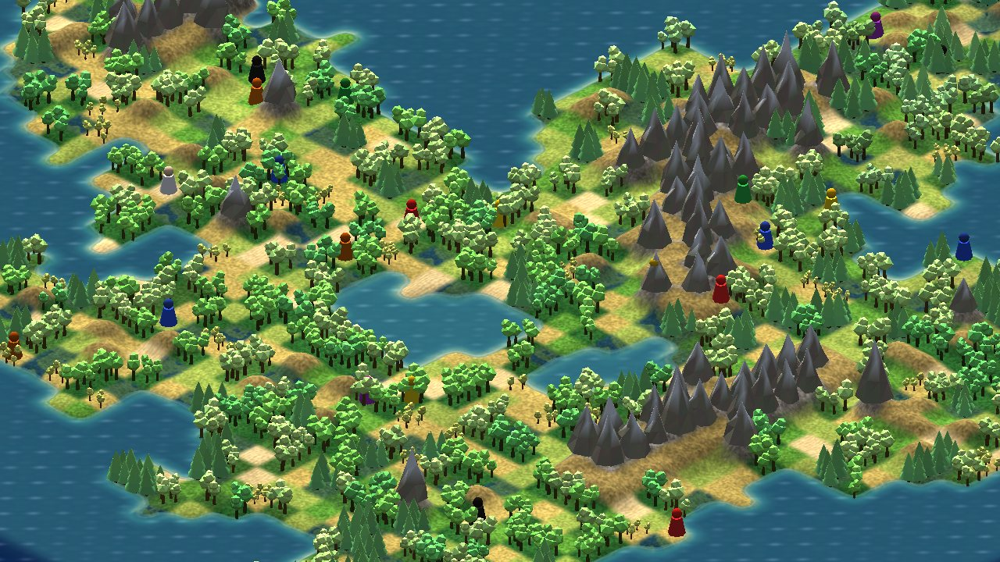 |
| **Far** | 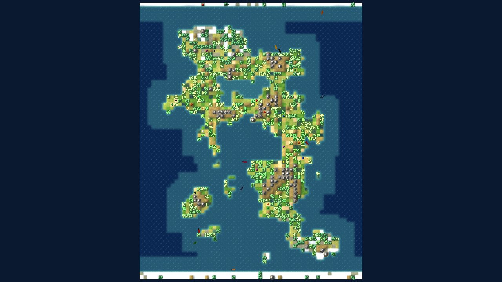 |  | 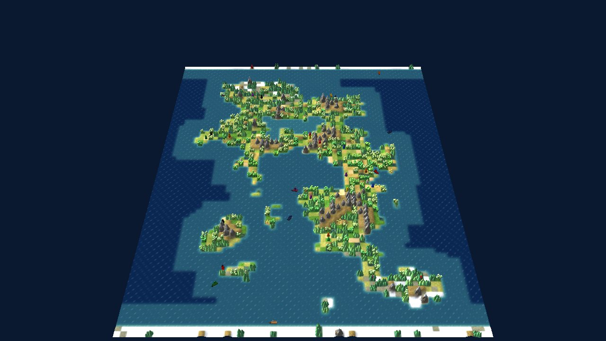 | 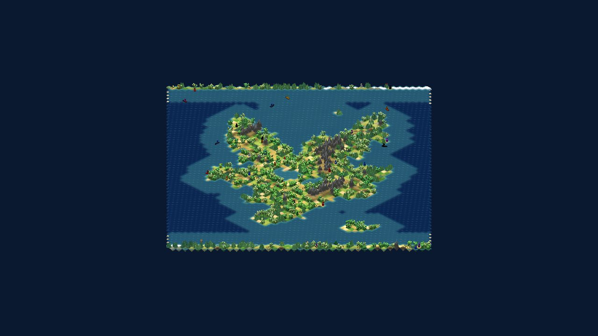 |
| **Near** | 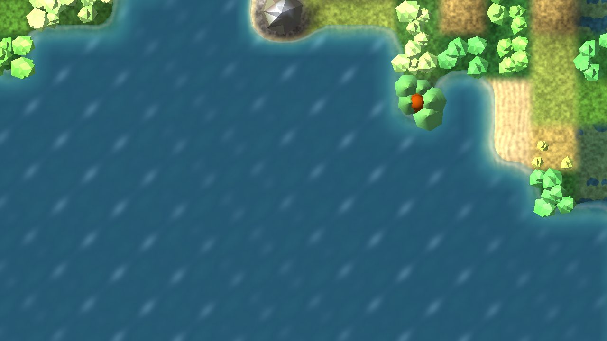 | 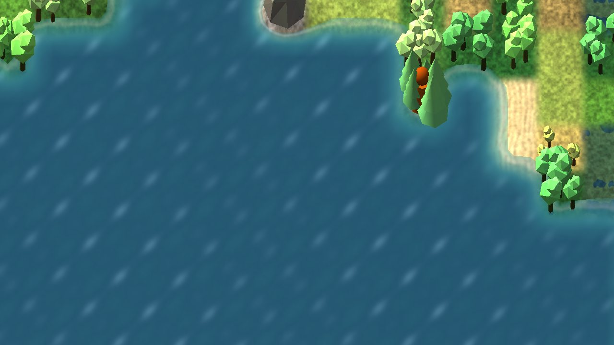 | 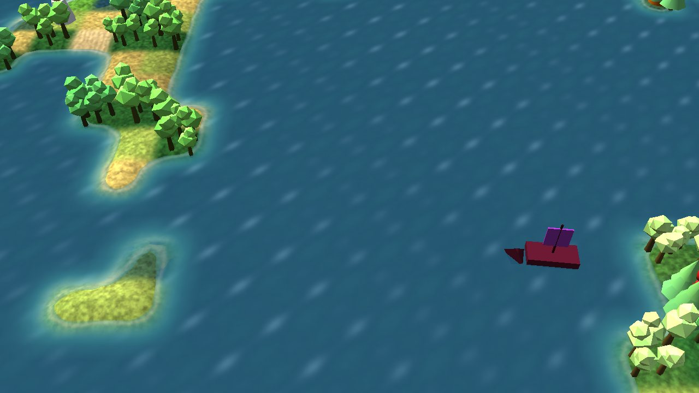 | 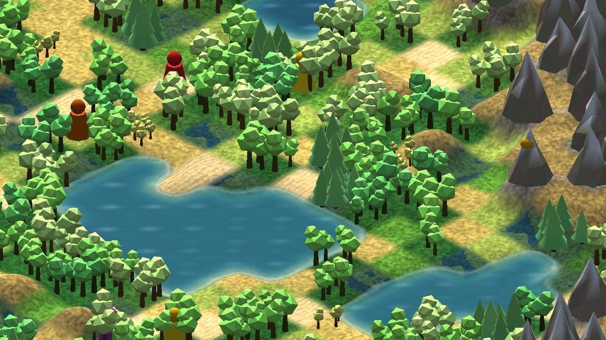 |

Grid on: [top-down](civ4-style-map/topdown-mid-grid.jpg), [oblique](civ4-style-map/oblique-mid-grid.jpg), [tilt](civ4-style-map/tilt-mid-grid.jpg), [isometric](civ4-style-map/isometric-mid-grid.jpg). The 70-degree Top-down variant I first used is `topdown70-mid.jpg`.

My own reading of the screenshots, with the grid off:

- **Water, forest, mountains and the coast read well in every camera, at every zoom.** Mountains are legible even with the whole map in view in all four.
- **Top-down straight reads worst**, as the owner said. Tree crowns are green blobs, peaks look like gems, units are balls. The ground is fine, but everything standing on it has lost its identity.
- **Colonization oblique reads best of the four for this game.** The ground is square and north up, so the tiles read like Colonization's. Trees, peaks, units and ships show their sides and stand up from the ground. A unit on a plain is clear. Whole-map view is as legible as the straight one.
- **Civ IV tilt looks the most like a world.** It has depth, but the far rows of tiles shrink to about 60% of the width of the near rows at the 45 degree pitch and 35 degree fov (`tilt-far.jpg`), and that is still readable: forests, mountains and coasts can be told apart at the top. The poles are small but legible. Tiles are trapezoids, so a hit test has to project, and labels and units at the top are smaller than at the bottom. With the whole map in view it leaves a wide empty band above it, so it fits the window a little worse than the oblique one.
- **Isometric looks good** on the Isometric-shaped map, and relief and models read as well as in the tilt. Each tile is a 2:1 diamond, so it uses more screen area per tile than the square cameras and its relief hides more of the ground behind it.
- **Hills are the weak spot in the Top-down and oblique cameras.** They show as brownish patches with soft shading, and the straight camera barely tells them from plains and desert. They read clearly in the tilt and Isometric cameras. They need either a model (a few rock mounds), a stronger texture, or more height (and in oblique more height means more shear, so the flat ground is the compromise).
- **Plains, prairie, savannah and tundra are too close in colour**, in all cameras. This is a texture and palette problem, not a camera problem.
- **Water at the oblique camera looked washed out** until I stopped scaling the water depth with the ground relief. Fixed in the prototype.

### Problems visible in the current shots, and what fixing each would cost

These are real faults in the prototype that a reviewer will see. The fixes are small in time and the costs are on the netbook budget, which is mostly pixels.

| Problem | Cause | Fix | Cost on the netbook |
|---|---|---|---|
| **Diamond and square patches where tile types meet** (the blend band is too narrow; the high-seas block at the left of `tilt-mid.jpg` is the clearest) | A band of 0.16 tile on a bilinear weight gives square corners | A wider band (0.34) and a noise-wobbled border. Tried in `oblique-mid-softer.jpg` and `tilt-mid-softer.jpg`: borders look natural. | Two more fetches from a 64x64 texture per pixel. Not measured, but small against four array samples; and the deep-sea colour should come from the water shader's depth, not the tile. |
| **Blurry ground close up** | 256 px layer over 2 tiles is about 1 texel a pixel at 96 px a tile, and the noise has no fine detail | A detail layer at 4x frequency (one more fetch, +20-25% fragment cost), or 512 px layers (4x texture memory: about 22 MB; slower first upload). Or cap the zoom. | The detail layer is the cheaper one; 512 px layers are hard on a netbook's bandwidth. Real photographic or painted textures need the detail anyway. |
| **Tiny units** | The pawn is 0.34 tall and about 0.5 tile wide, at 1.7x scale | Scale to 2.5-3x, add a dark outline (inverted hull) and a nation-colour base disc | Nearly free. 50 units are one instanced draw call; an outline pass doubles their triangles (a few hundred). |
| **A tree covers a unit, and dense forests hide units** | Trees are tall and are drawn by depth like the unit. In oblique, the south tree row draws over the north row, by design | Draw units last with the depth test off against trees (a silhouette-through-trees look, as Colonization did), or drop the trees within 0.4 tile of a unit. Fewer trees where a unit stands. | The first is one more draw call and free fill. The second is a CPU update of the tree instances when units move. Per-unit fading with alpha would cost sorting and overdraw: avoid it. |

Also **not built:** shadows (the brief asked me to check them in the oblique view; there are none, so I could not). Shadow maps would cost a second depth pass and a shadow texture, about 10-20% on this scene and more on a netbook, and a baked ambient occlusion on the ground is the cheaper way to ground trees. Rivers, roads, fog, selection and settlements are not drawn.

## Fallback: WebGL1 or no WebGL

Two options for a Canvas 2D path:

- **A pre-rendered picture of the map.** Render the 3D scene once, off-screen at several scales, and draw the image with pan and zoom. It looks like the 3D map, but it can't change: units and the fog still need sprites on top, a turn changes tiles (a colony, a road), and the picture needs a rebuild. Without WebGL there is nothing to render it with, so this only works if the picture is made on the server or on a machine that has it (not realistic for a client-only game).
- **The existing 2D Tileset art** (what we have now). This is what the game already draws and what the Tileset mods give. It costs nothing new and keeps the game playable, and it makes the Isometric 2D and Top-down 2D paths stay in the code. I'd keep this one: **the 3D map is an optional kind of Tileset, and the Canvas path stays the 2D renderer.** I did not build it.

## The art pipeline it would need

- **Ground textures, 16-24 seamless tiles at 256 or 512 px**, plus a detail layer. Source: an artist painting them in one style, or free CC0 PBR sets (ambientCG, Poly Haven) recoloured to a palette. Both are cheap; one style comes from a shared palette and a rule: low saturation, one sun angle baked out.
- **Models:** about 6-8 tree models (conifer, broadleaf, palm, scrub), 3-4 peak models, a few hill mounds, a ship set, a unit set (or the existing sprites as billboards) and colony buildings. At 300-800 triangles each.
- **Meshy** can make these. Its listed prices (the MCP guide and meshy.ai/pricing, not spent): a game asset in smart topology (`meshy-t2` or `meshy-t2.5`) costs 5 credits for the mesh and 15 with texture; a text-to-3D route costs 5 credits for the preview mesh, 10 for the texture refine and 5 to remesh to a polygon budget (20 in all); rigging 5; animation 3 an action. A credit is about $0.02 on the Pro plan ($20 for 1,000), about $0.0125 on Ultra. So a textured low-poly model is **about 15-20 credits, or $0.20-0.40**, and a 40-model set with three tries each is about **$25-50**. That is cheap. The risk is not money but consistency: Meshy models differ in scale, texture style and orientation, so each needs a pass (resize, 5 credits, in a fixed polycount, and a shared palette or retexture). I'd define the style first with 3 trees and 3 peaks, and have an artist set the bar.
- **Keeping one style:** one palette file, one sun direction and one ambient (already shared in the prototype), one scale rule (a tree is 0.8-1.2 tile tall, a peak 1.0-1.5), a polycount budget per model, and flat shading or vertex colours so the shader does the look. A single artist, or a single prompt template plus review for Meshy.
- **Mods:** the existing FreeCol and BrowserCol Tilesets are 2D images of diamond tiles. They cannot be used on a 3D ground. ADR 0003's Tileset system would need a 3D kind, with its own model and texture manifest, and the existing mods would not work in it.

## Effort estimate

For one developer who knows the Browser UI, replacing the 2D map renderer (`map.ts` 2,653 lines, `map-tilemap.ts` 597, `map-water.ts` 1,176, `tileset.ts` 1,049, `pointer.ts` 488, `minimap.ts` 161) while the 2D one stays as the fallback:

| Part | Weeks |
|---|---|
| Terrain, relief, water and shore, ground blending, the camera, the Map-view switching and the render loop in the Pixi/React page, resize, DPR cap, low preset | 3 |
| Rivers, roads, coasts, resources and tile items as ribbons and decals | 2 |
| Units, colonies, settlements and ships (sprites as billboards at first, models later), unit-move animation, labels | 2.5 |
| Fog and the explore cover (a per-tile mask texture in the ground shader) | 1 |
| Selection, goto, borders, path and other overlays | 1.5 |
| Hit testing and input: a tile and a unit under the pointer, edge scroll, camera clamp. `Projection` assumes a flat 2D mapping; a perspective camera is not one, so every user of `tileAt`/`origin` changes | 2 |
| Minimap (can stay 2D from tile data) | 0.5 |
| Colony panel's 3x3 tiles (a second small canvas or tile pictures rendered once from the scene) | 1 |
| Fallback: keeping the 2D renderer working next to it, and switching | 1 |
| Cross-browser and low-end tuning, the browser scripts (`smoke`, `play`, `tileset`) and tests | 2 |
| **Engineering total** | **about 16 weeks** |
| Art: a style, ground textures, models and the unit and colony set, from an artist or Meshy plus an artist's passes | **4-8 weeks** |

If only the oblique or tilt camera is offered, hit testing is easier (the oblique one is a shear, which inverts exactly), and the total falls by about 2 weeks. A reduced first step is **a WebGL ground, water and relief layer with the existing sprites as billboards**: about 7-8 weeks, and it keeps units, colonies and the Tileset mods.

## Risks

- **Art, not code.** The prototype is cheap to run. A look the owner accepts, with models that match each other, is the real project, and it can be weeks of rejected models.
- **WebGL2 and weak GPUs.** Software GL runs at 5 fps. Old Intel parts without WebGL2, driver bugs and blocklists mean the 2D path must remain a first-class path, and it has to be tested.
- **Fill rate on a netbook** at high-dpi screens: a resolution cap and a low preset are required, not optional. My estimate for a netbook is a guess until someone measures one.
- **Tileset mods stop working in the 3D map** (ADR 0003), and every new art asset is 3D.
- **Input and overlays.** Everything that does arithmetic on the flat projection must go through a camera. The tilt makes this hardest.
- **Bundle and load size:** three.js's module files are 2.1 MB unminified, about 420 KB gzipped, before tree-shaking (a bundler would shrink that; not measured). Raw WebGL2 would be smaller, at more code.
- **Oblique and relief:** a sheared hill slides up off its tile, so relief must be flattened, and hills get less visible.
- **Team focus.** ADR 0003 and the memory note already put procedural art after 2.0.

## Recommendation: go-later

1. **Offer two cameras, not four.** **Colonization oblique** should be the main one: it keeps the square, north-up map and the flat poles of the Top-down shape, and it fixes the exact thing that makes straight Top-down read badly. **Civ IV tilt** is the second, as a "look" option on the same Top-down map: it is the prettiest, but it costs input complexity and screen space. Top-down straight is only what the oblique is with k = 0, so it comes free. **Isometric** needs no 3D: FreeCol's own diamond art already does it, so keep the 2D Isometric renderer rather than adding a 3D version of it, unless the 3D one is cheap once the rest exists (it is: a camera yaw).
2. **No-go for now, go after 1.0** (this agrees with the "procedural is post-2.0" note). The prototype shows the numbers are fine for an integrated GPU; it does not show that we can make it look good, and that decides it.
3. **Before committing, spend one week** on the art question: an artist or one Meshy batch of 3 trees, 3 peaks and 2 ground sets in a style the owner approves, rendered in the oblique camera of this prototype. If that shot passes, schedule the 7-8 week ground-and-relief layer first.
4. **Measure a real netbook** (or an Intel HD 500-class laptop) with `tools/proto-civ4-map/` before any decision on the resolution cap.
